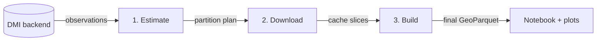

# DMI GeoParquet

DMI GeoParquet turns DMI `metObs` weather-station observations into GeoParquet datasets.

## Purpose

The package exists to make DMI weather-station data easy to:

- estimate before downloading
- cache locally in a deterministic layout
- build final partitioned GeoParquet outputs
- open as `xarray.Dataset` for analysis and plotting

## What It Does

- estimates partition sizes and fetch time from live DMI or local samples
- downloads observations into per-variable GeoParquet cache slices
- builds final GeoParquet partitions from the cache
- provides a reader for cached GeoParquet data as `xarray`
- provides a simple plotting helper for inspecting cached timeseries

Current scope:

- DMI weather stations only
- initial parameters: `temp_dry`, `temp_dew`, `wind_speed`

## How It Works



The pipeline is split into three stages:

1. `estimate-partitions`
   - samples DMI or local input
   - estimates file sizes for candidate partition schemes
   - estimates download time from the same sample

2. `build-cache`
   - downloads observations from the DMI API
   - writes GeoParquet cache files per parameter and time slice
   - uses a stable folder layout so runs are resumable and deterministic

3. `build-final`
   - reads the cache
   - normalizes year/month partition columns
   - writes the final partitioned GeoParquet dataset

### Design

- The code is organized into stage subpackages:
  - `dmi_geoparquet.estimate`
  - `dmi_geoparquet.download`
  - `dmi_geoparquet.build`
- The cache and final stages use `year` and `month` partition columns so output is predictable.
- Each stage is kept separate so it can be tested and run independently.
- The reader stays separate from the writers so analysis code does not depend on the download path.
- The cache layout is intentionally simple and stable:

```text
tmp/
  cache/
    temp_dry/monthly/year=2025/month=07/part-00000.parquet
    temp_dew/monthly/year=2025/month=07/part-00000.parquet
    wind_speed/monthly/year=2025/month=07/part-00000.parquet

data/
  dmi/raw/year=2025/month=07/part-00000.parquet
```

## CLI

```text
dmi-geoparquet estimate-partitions
dmi-geoparquet build-cache
dmi-geoparquet build-final
dmi-geoparquet plot-timeseries
```

Example full-year raw backfill:

```bash
uv run dmi-geoparquet build-final \
  --cache tmp/cache \
  --download-missing-data \
  --start 2025-01-01 \
  --end 2026-01-01 \
  --output data/dmi
```

Defaults:

- cache output: `tmp/cache`
- plots output: `tmp/plots`
- final output: `data/dmi`

## Docker Service

`docker compose up -d --build` runs three services:

- `updater` runs `dmi-geoparquet update` every 3 hours. Each cycle backfills missing
  monthly cache slices from `DMI_START_DATE`, re-downloads the slices covering the
  last 3 days (so late and new observations are picked up), and rebuilds `data/dmi`.
- `server` (nginx) serves a status page at `http://localhost:8080/` and the dataset
  below it with directory listings, HTTP Range requests and CORS.
- `s3-listing` answers S3 bucket listing requests, so the same files are also a
  read-only, anonymous S3 bucket named `s3` (path-style, endpoint = the nginx
  server). nginx serves object reads itself and forwards only bucket-level requests
  (`/s3?list-type=2…`) to this service. With a bucket, pandas, pyarrow, DuckDB and
  GeoPandas discover the `year=…/month=…` partitions themselves:

```python
df = pd.read_parquet(
    "s3://s3/raw/",
    storage_options={"anon": True, "endpoint_url": "http://localhost:8080"},
    filters=[("year", "=", 2026), ("month", "=", 8)],
)
```

`/pyodide.html` runs a GeoPandas + matplotlib example in the browser with
[Pyodide](https://pyodide.org), loaded from the jsDelivr CDN (about 30 MB on the first
visit, then cached). It reads the same files over plain HTTP, because S3 clients don't
run in browsers.

The status page shows one row per month and one column per parameter, with each
block marked `waiting`, `processing`, `done`, `no data` or `error`, plus a link to
the final file for that month. It polls `data/dmi/_status.json`, which the updater
rewrites after every block, so the web server never waits on processing. A failed
block is recorded with its error and the cycle continues with the remaining blocks.

`./data` and `./tmp/cache` are bind-mounted, so downloads persist on the host across
container restarts. The updater runs as the owner of `./data`, so written files keep
your host user's ownership. Configure with `DMI_START_DATE`,
`DMI_UPDATE_INTERVAL_HOURS` and `HTTP_PORT`. Run a single cycle locally with
`uv run dmi-geoparquet update --start 2025-01-01 --once`.

## Python API

- `dmi_geoparquet.open_dataset(...)` opens cached GeoParquet as `xarray.Dataset`
- `dmi_geoparquet.estimate` contains the estimation helpers
- `dmi_geoparquet.download` contains the cache builder
- `dmi_geoparquet.build` contains the final dataset builder

## Development

```bash
uv sync --dev
uv run ruff check .
uv run ty check
```
